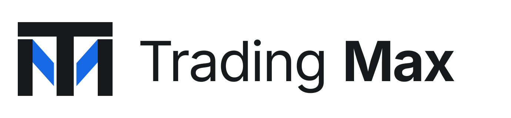
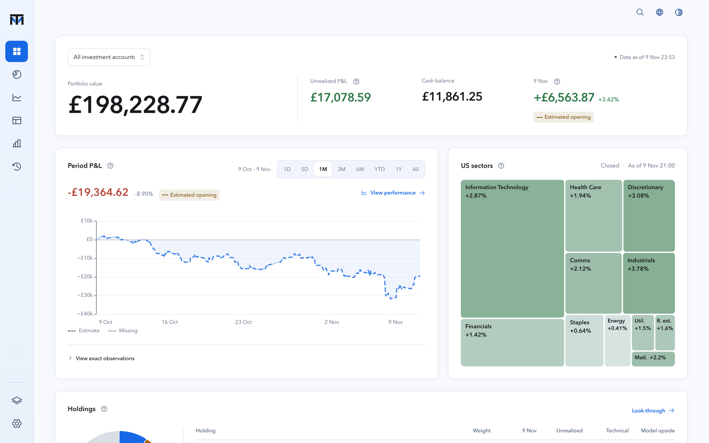
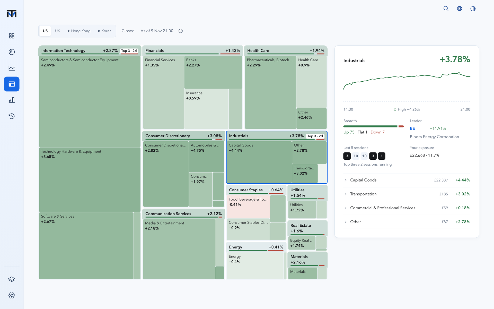
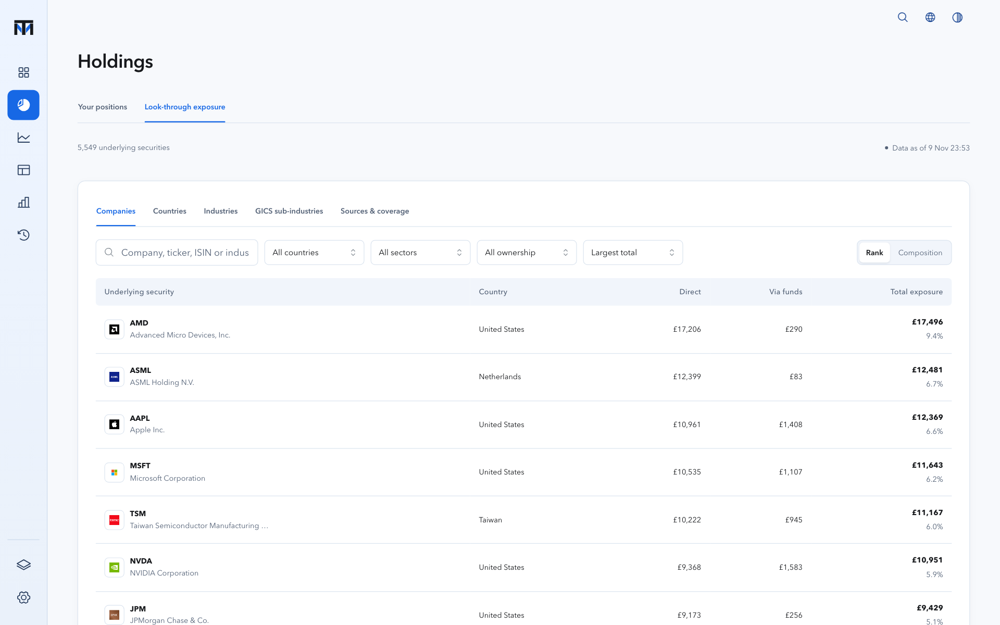
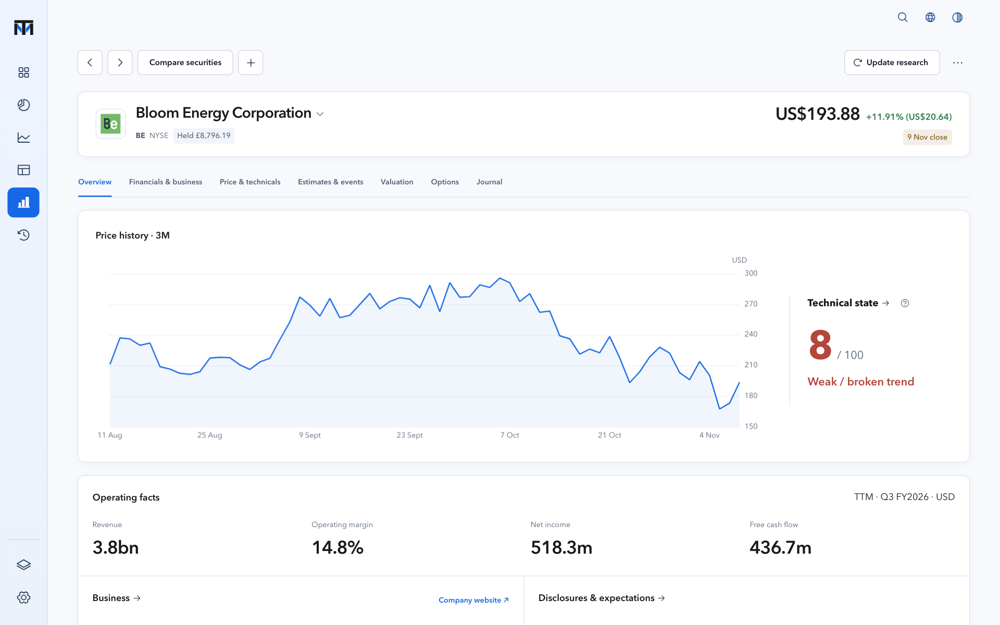
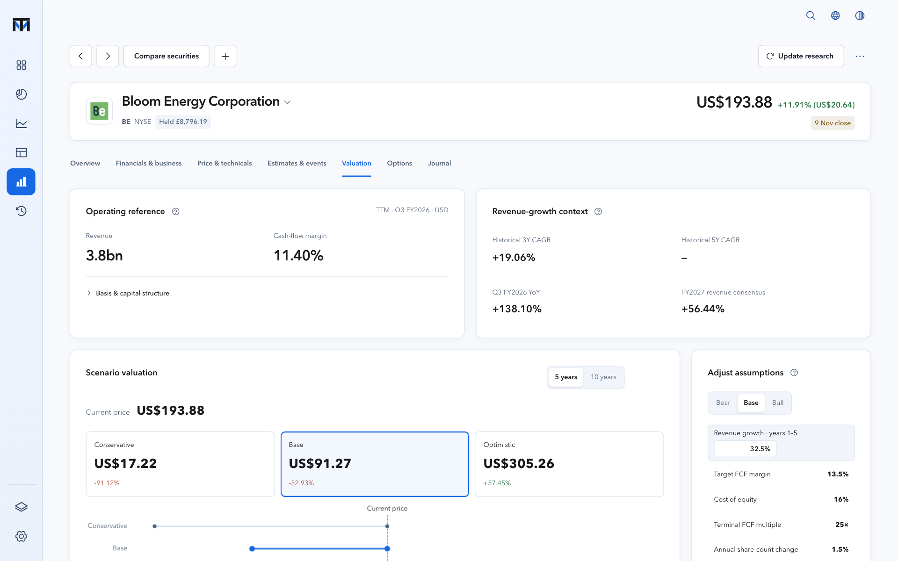

<p align="center">
  <picture>
    <source media="(prefers-color-scheme: dark)" srcset="apps/web/public/brand/trading-max-lockup-dark.svg">
    
  </picture>
</p>

<h3 align="center">Your portfolio, explained.</h3>

<p align="center">
  A private, read-only investment workspace for Trading 212.<br>
  See what changed, look beneath every fund, follow today's sectors and keep research beside your positions.
</p>

<p align="center">
  <a href="https://github.com/engramai-co/trading-max/releases/latest"></a>
  <a href="https://github.com/engramai-co/trading-max/releases/latest"></a>
  <a href="LICENSE"></a>
  
</p>

<p align="center">
  <a href="https://tradingmax.engramai.co"><b>Website</b></a> ·
  <a href="https://github.com/engramai-co/trading-max/releases/latest"><b>Download for Mac</b></a> ·
  <a href="#run-from-source"><b>Run from source</b></a> ·
  <a href="docs/README.md"><b>Guides</b></a>
</p>

<p align="center">
  
</p>

## What you get

- **Results, not deposits.** Investment results stay separate from money moving
  in and out, for Invest and Stocks ISA together or one account at a time.
- **Today's sectors.** Sector maps for the US, UK, Hong Kong and Korea, sized by
  index weight and coloured by the session's move, with your own exposure beside
  each sector.
- **Look-through.** Your direct shares combined with the constituents ETF issuers
  publish: the companies, sectors and countries you actually own, and where they
  overlap.
- **Research beside your positions.** Up to seven views per security, from the
  business and its financials to price, estimates, valuation scenarios, options
  and your journal. Your buys, sells and trims sit on the charts.
- **Decision review.** Past trades set against what happened next.

<p align="center">
  
  
</p>
<p align="center">
  
  
</p>

<p align="center"><sub>Screenshots use a hypothetical portfolio. Market and company data come from real providers and show dated examples, not live quotes.</sub></p>

## Get started

### Mac App

1. Download the DMG from the [latest release](https://github.com/engramai-co/trading-max/releases/latest).
   It runs on Apple Silicon and is Developer ID signed and Apple-notarized.
2. Open it and drag **Trading Max Preview** to Applications.
3. Start a local workspace, connect to your own Trading Max service over HTTPS,
   or open the demo with synthetic data.
4. Add your read-only Trading 212 API keys in **Settings**, run the first sync
   and check the totals against Trading 212.

Updates install from **App Settings → About & updates**. See the
[desktop guide](docs/installation/desktop-onboarding.md).

### Run from source

You need Git, Python 3.12, [uv](https://docs.astral.sh/uv/) and Node.js 22
(22.19 or newer).

```bash
git clone https://github.com/engramai-co/trading-max.git
cd trading-max
uv run --package trading-max-backend trading-max onboard
deploy/local/start.sh
```

Then open <http://127.0.0.1:3413>. `onboard` installs the locked dependencies,
keeps your data outside the checkout, builds the web app and can connect
Trading 212. The [source guide](docs/archive/onboarding/local-installation.md)
covers background services, updates and backups.

## Your data stays yours

- **Read-only.** There is no order-placement path. Trading Max never trades.
- **Local.** Credentials live in the operating-system keychain. Data stays on
  your machine or your own server, on loopback by default.
- **Sourced.** Every figure keeps its basis, source and as-of time. Stale or
  failed data is disclosed, never papered over.
- **AI optional.** Analytics and research work without a model key.

Trading 212 supplies account data; Yahoo-compatible market data and disclosure
filings supply research. See [Privacy](PRIVACY.md) and
[data conventions](docs/guides/data-and-metrics.md).

## Learn more

| I want to… | Start here |
|---|---|
| Understand my portfolio | [Portfolio guide](docs/guides/portfolio.md) |
| Research a company or build a valuation | [Research guide](docs/guides/research.md) |
| Install, update or recover the App | [Desktop guide](docs/installation/desktop-updates.md) |
| Understand the architecture or API | [Documentation index](docs/README.md) |
| Get help or contribute | [Support](SUPPORT.md) · [Contributing](CONTRIBUTING.md) |
| See what shipped | [Changelog](CHANGELOG.md) · [Releases](https://github.com/engramai-co/trading-max/releases) |

## License

Trading Max is open source under the [Apache License 2.0](LICENSE). It is an
independent project, not affiliated with or endorsed by Trading 212, Yahoo,
Bloomberg/OpenFIGI, ETF issuers or model providers, and nothing here is
investment advice. See [third-party notices](THIRD_PARTY_NOTICES.md) and
[trademarks](TRADEMARKS.md).
